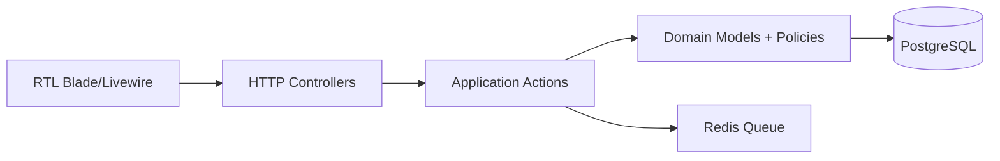

# معماری

معماری Modular Monolith است. مرزهای دامنه در `app/Domain` قرار دارند و Controllerها فقط orchestration انجام می‌دهند.

ماژول‌های اصلی: Tenancy, Identity, Vehicles, Parts, Catalog, Fitment, Inventory, Procurement, Sales, Accounting, Reporting, Audit.

## ADR-001

Shared database با scope صریح `organization_id`/`store_id` برای رشد SaaS انتخاب شد؛ داده مرجع عمومی در جداول بدون tenant نگه‌داری می‌شود.
